<p align="center">
  
</p>

<h1 align="center">HazardWatch</h1>

<p align="center">
  Earthquakes, wildfires, cyclones and floods on a live globe, from open data,<br />
  with alerts when they reach the places you watch.
</p>

<p align="center">
  <a href="https://hazardwatch-bay.vercel.app"><strong>Open the live map</strong></a>
  &nbsp;·&nbsp;
  <a href="docs/architecture.md">Architecture</a>
  &nbsp;·&nbsp;
  <a href="docs/deployment.md">Deploy your own</a>
</p>

<p align="center">
  <a href="https://github.com/HIRATRA/hazardwatch/actions/workflows/ci.yml"></a>
  <a href="LICENSE"></a>
  
  
</p>

<p align="center">
  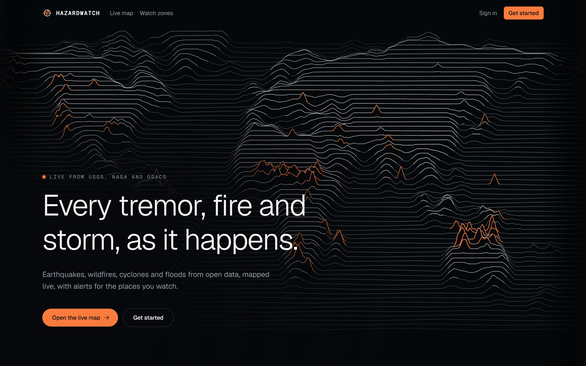
</p>

## What it does

HazardWatch follows natural hazards around the world as they happen. A
worker polls public feeds every few minutes, turns their very different
formats into a single kind of event and stores them in PostGIS. The web app
shows them on a 3D globe, over live satellite imagery if you like, and lets
you draw watch zones around the places you care about: an office, a
supplier, a family's town. When an event reaches one of them, you get an
alert in the app, by email and as a notification on your devices.

Everything runs on public data and free hosting tiers, without a single API
key.

### A live globe of every hazard

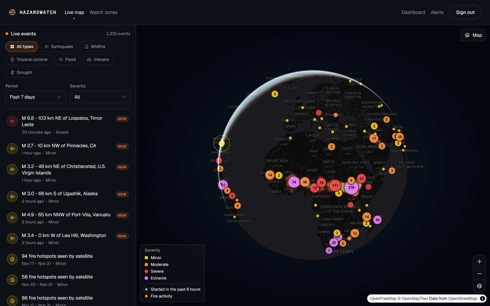

- **Every source on one map.** Earthquakes from USGS, fires detected from
  orbit by NASA FIRMS, cyclones, floods, volcanoes and droughts from GDACS,
  refreshed every minute.
- **Readable at any zoom.** Events merge into clusters coloured by their
  most severe event, fires glow as a heatmap, and events that started in
  the past six hours pulse.
- **Every event seen from orbit.** Its card shows the area around it as
  NOAA-20 pictured it on its last day of activity, with fires in red, and
  steps back and forth in days.
- **Shareable views.** Filters by type, period and severity live in the URL,
  so any view can be bookmarked or sent.

### The planet seen from orbit

The basemap switches to NASA imagery, fetched by the browser straight from
NASA GIBS.

<table>
  <tr>
    <td valign="top" width="33%">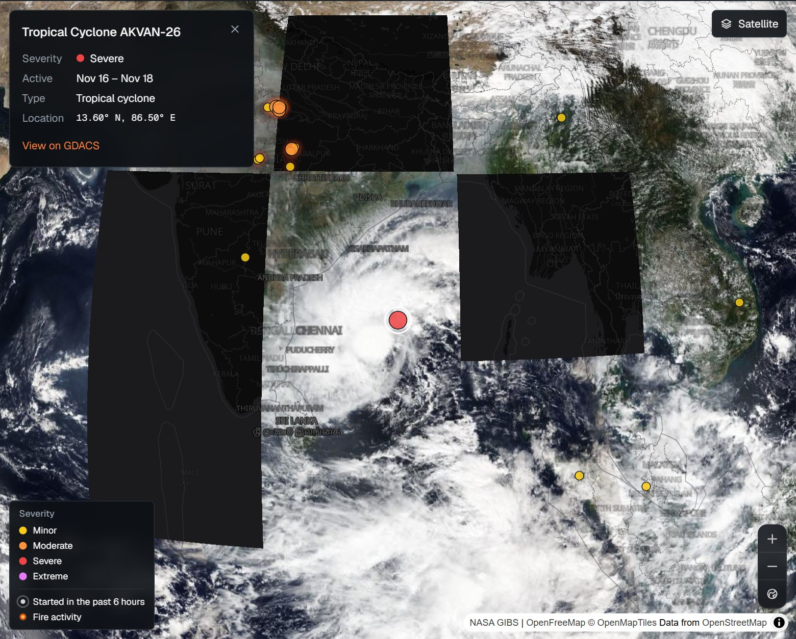</td>
    <td valign="top" width="33%">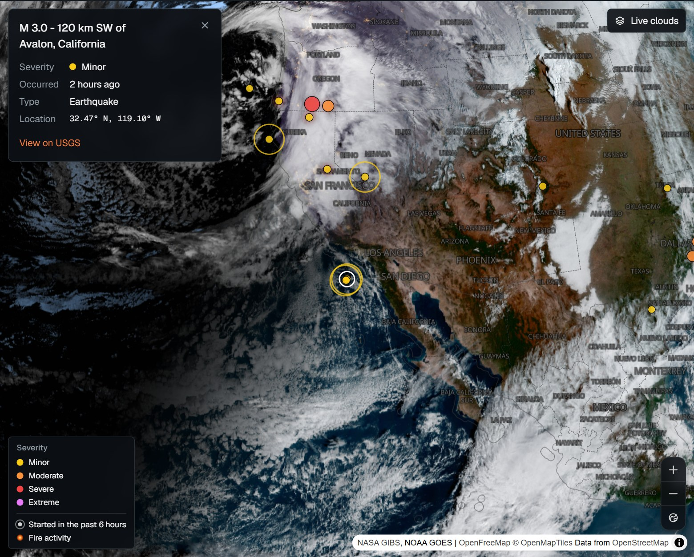</td>
    <td valign="top" width="33%">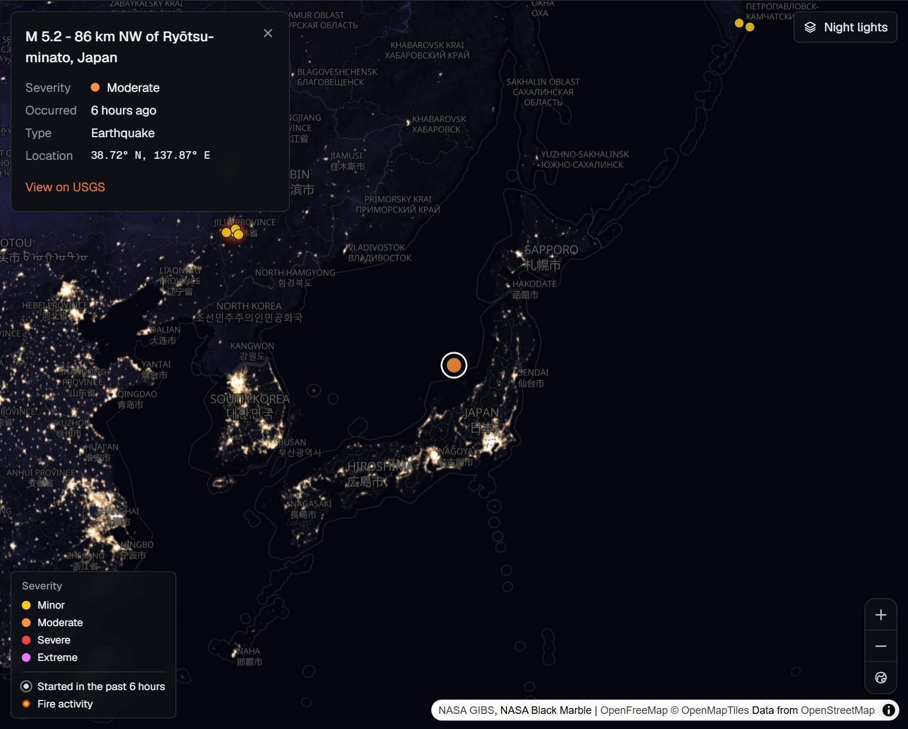</td>
  </tr>
  <tr>
    <td valign="top"><strong>Satellite</strong><br />True colour of the last complete day, here Tropical Cyclone Akvan over the Bay of Bengal.</td>
    <td valign="top"><strong>Live clouds</strong><br />A new image every ten minutes from the GOES satellites, over the Americas and the Pacific.</td>
    <td valign="top"><strong>Night lights</strong><br />The Black Marble composite of city lights, here around the Sea of Japan.</td>
  </tr>
</table>

### Watch zones and alerts

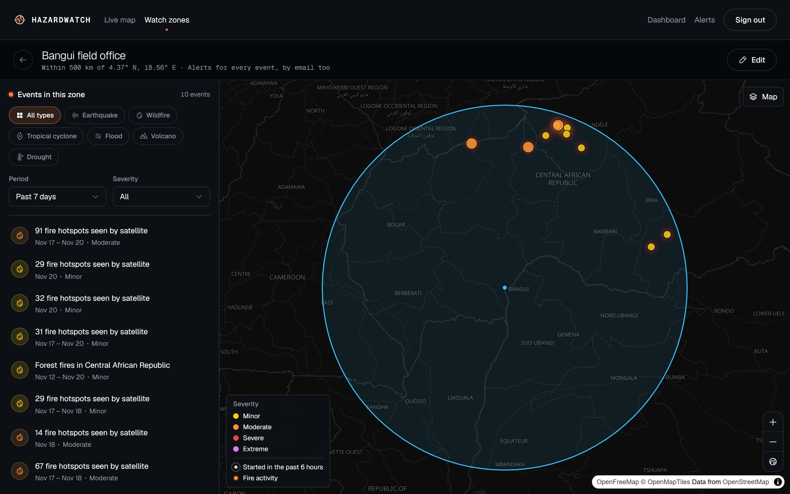

A watch zone is a circle of 10 to 1,000 km around any point, drawn on the
map or typed in. Its page shows the hazards inside it. When a new event
reaches a zone at or above the severity chosen for it, an alert appears in
the app and, once the address is confirmed, in a digest email. Turn
notifications on from the alerts page, and each device you choose gets
them within a minute, phones included once the app is installed.

<table>
  <tr>
    <td valign="top" width="58%">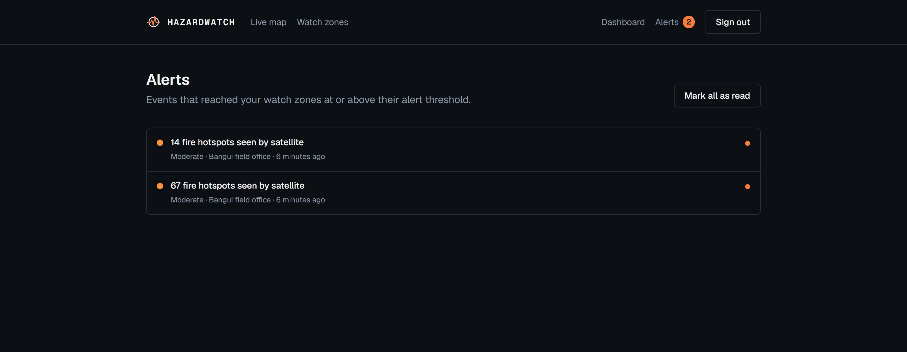</td>
    <td valign="top" width="42%">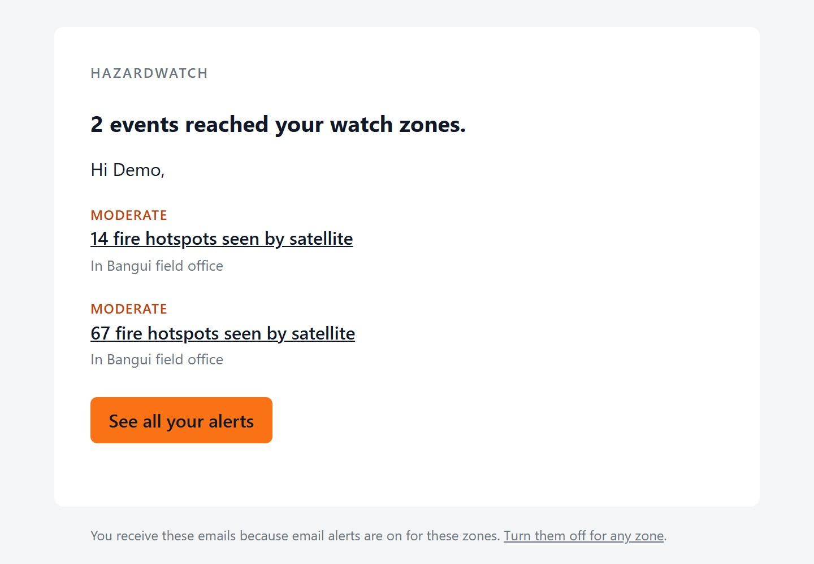</td>
  </tr>
  <tr>
    <td valign="top"><strong>In the app</strong>, with an unread count in the header.</td>
    <td valign="top"><strong>By email</strong>, in one digest every two minutes at most.</td>
  </tr>
</table>

### On any screen

<p align="center">
  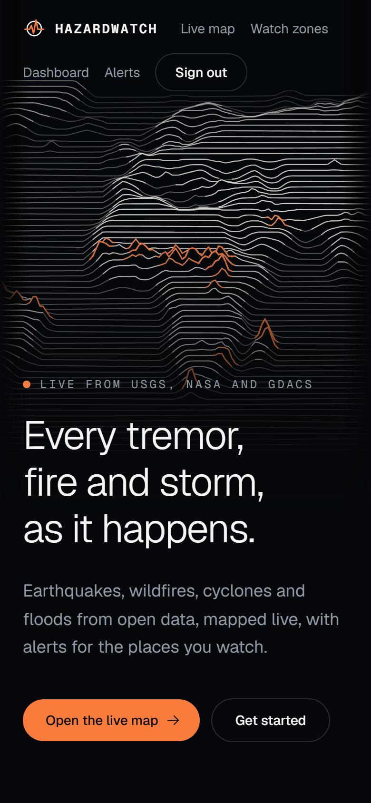
  &nbsp;&nbsp;&nbsp;
  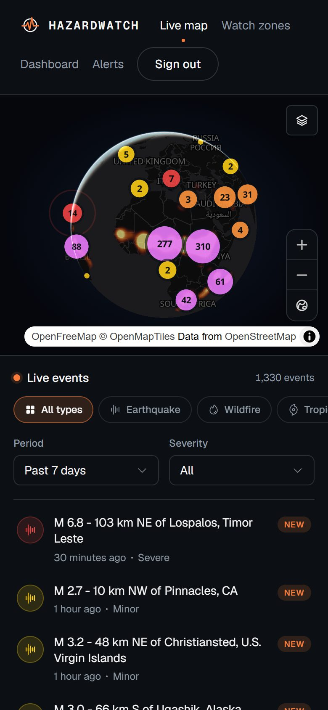
</p>

## How it works

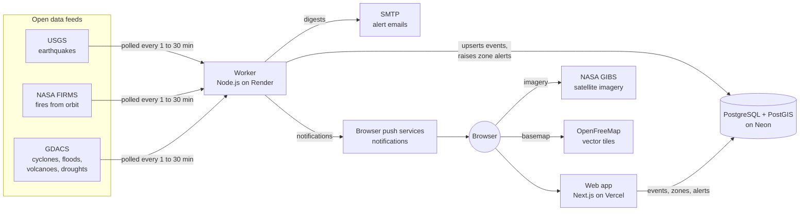

1. **Ingestion.** The worker polls each feed on its own interval and maps
   it to one event model: a kind, a severity, a location and a period of
   activity. Satellite fire detections, about 100,000 a day, are grouped
   into fires by cells of 0.25°.
2. **Alerts.** In the same transaction that writes the events, a single
   PostGIS query matches them against every watch zone, on the surface of
   the Earth, and raises the alerts that pass each zone's threshold.
3. **Email and push.** Every two minutes, the worker claims the alerts
   waiting for an email and sends each confirmed user one digest. Every
   minute, it pushes the new ones to the browsers that turned
   notifications on, through the Web Push protocol.
4. **Web.** Pages are React Server Components reading the database. The
   map runs MapLibre in the browser, which also loads the imagery from NASA
   directly, so the server never proxies a tile.

The reasoning behind each choice is recorded in
[architecture decision records](docs/adr/README.md), such as
[modelling events as activity periods](docs/adr/0006-model-hazard-events-as-activity-periods.md),
[raising alerts when events are written](docs/adr/0008-raise-alerts-when-events-are-written.md)
or [grouping fire detections into grid cells](docs/adr/0011-group-satellite-fire-detections-into-grid-cells.md).

## Tech stack

| Layer        | Technologies                                                                                                                                                                                                                                                                                                                                                                                                                                                                                                                                                                                                             |
| ------------ | ------------------------------------------------------------------------------------------------------------------------------------------------------------------------------------------------------------------------------------------------------------------------------------------------------------------------------------------------------------------------------------------------------------------------------------------------------------------------------------------------------------------------------------------------------------------------------------------------------------------------ |
| **Frontend** |       |
| **Maps**     |                                                                                                                                                                                                                                                                                    |
| **Backend**  |                                                                                                                                                                                                     |
| **Data**     |                                                                                                                                                                                                                                                                                                                    |
| **Quality**  |                                                              |
| **Tooling**  |                                                                                                                                                                                           |
| **Hosting**  |                                                                                                                                                                                                                                                                                                                      |

A few things worth knowing about how they fit together:

- **One TypeScript monorepo**, with pnpm workspaces and Turborepo: two apps
  and two shared packages, type-checked and linted together.
- **Geospatial work happens in the database.** Events and zones are PostGIS
  geographies, so "is this event within 250 km of that point" is one
  indexed query, measured on the Earth rather than on a flat map.
- **No map provider account.** Vector tiles come from OpenFreeMap and
  imagery from NASA, both free and keyless.
- **Free to run.** Vercel hosts the web app, Render the worker, kept awake
  by an uptime monitor, and Neon the database.

## Data sources

| Source                                                  | What it provides                                                     | Polled           |
| ------------------------------------------------------- | -------------------------------------------------------------------- | ---------------- |
| [USGS](https://earthquake.usgs.gov/earthquakes/feed/)   | Earthquakes worldwide                                                | Every minute     |
| [NASA FIRMS](https://firms.modaps.eosdis.nasa.gov/)     | Fires detected by the VIIRS instruments of NOAA-20 and NOAA-21       | Every 30 minutes |
| [GDACS](https://www.gdacs.org/)                         | Tropical cyclones, floods, volcanoes and droughts, with their impact | Every 10 minutes |
| [NASA GIBS](https://nasa-gibs.github.io/gibs-api-docs/) | Satellite imagery: true colour, live clouds and city lights          | By the browser   |
| [OpenFreeMap](https://openfreemap.org/)                 | Vector tiles built from OpenStreetMap                                | By the browser   |

Data may be delayed or incomplete. HazardWatch is not meant for emergency
response.

## Getting started

You need Node.js 22.12 or later, pnpm 10 and Docker.

```sh
pnpm install
cp .env.example .env    # then set BETTER_AUTH_SECRET
docker compose up -d    # PostgreSQL with PostGIS on port 5433, Mailpit on 1025
pnpm db:migrate
pnpm dev                # web app and worker
```

The web app runs on <http://localhost:3000>. Generate a secret with
`openssl rand -base64 32`. Emails sent in development never leave your
machine: Mailpit catches them and shows them on <http://localhost:8025>.

| Command                 | What it does                                    |
| ----------------------- | ----------------------------------------------- |
| `pnpm dev`              | Starts the web app and the worker in watch mode |
| `pnpm test`             | Runs the unit tests                             |
| `pnpm test:integration` | Runs the tests against a real PostGIS database  |
| `pnpm lint`             | Lints every workspace                           |
| `pnpm typecheck`        | Type-checks every workspace                     |
| `pnpm build`            | Builds everything, as the CI does               |

## Project structure

```
apps/
  web/          Next.js app: pages, authentication, server actions, the globe
  worker/       Polls the hazard feeds, raises alerts and sends their emails
packages/
  db/           Drizzle schema, PostGIS queries and migrations
  email/        Email templates and sending
docs/
  architecture.md
  deployment.md
  adr/          Architecture decision records
```

## Documentation

- [Architecture](docs/architecture.md): the moving parts, how data flows
  between them and the principles behind the code.
- [Deployment](docs/deployment.md): setting up Neon, Vercel and Render, all
  on free tiers.
- [Decision records](docs/adr/README.md): why PostGIS, Better Auth, a
  dedicated worker, MapLibre, the globe and more.
- [Contributing](CONTRIBUTING.md): workflow, branch names and commit
  conventions.

## Credits

Designed & Built by [Hiratra Danarson](https://github.com/HIRATRA).

Events from [USGS](https://www.usgs.gov/), [NASA FIRMS](https://firms.modaps.eosdis.nasa.gov/)
and [GDACS](https://www.gdacs.org/). Imagery from NASA's Global Imagery
Browse Services (GIBS), part of NASA's Earth Science Data and Information
System (ESDIS). Maps from [OpenFreeMap](https://openfreemap.org/) and
OpenStreetMap contributors. Land outlines from
[Natural Earth](https://www.naturalearthdata.com/).

## License

[MIT](LICENSE)
