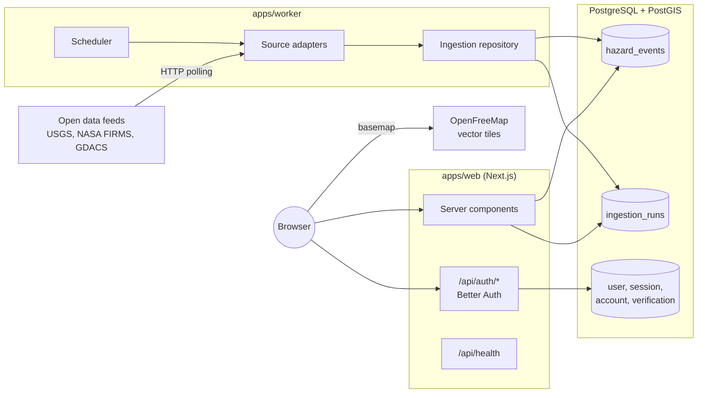
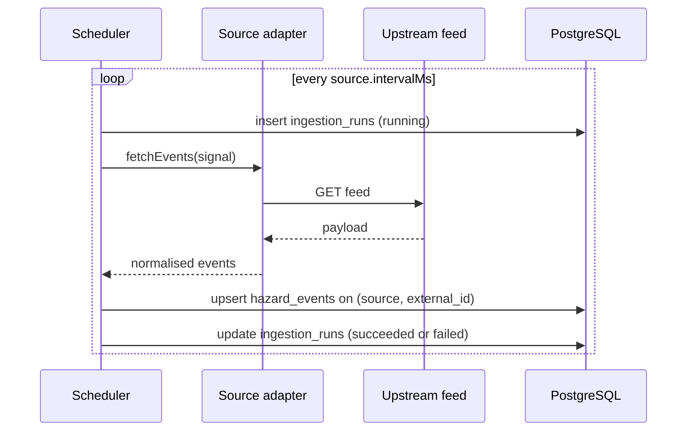

# Architecture

This document describes how HazardWatch is put together: the moving parts,
how data flows between them and the principles that guide new code. The
reasoning behind individual choices lives in the
[architecture decision records](adr/README.md).

## Overview

HazardWatch is a TypeScript monorepo with two deployable applications that
share one PostgreSQL database.

| Package       | Responsibility                                                 |
| ------------- | -------------------------------------------------------------- |
| `apps/web`    | User-facing application: pages, authentication, HTTP endpoints |
| `apps/worker` | Long-running process that polls hazard feeds and stores events |
| `packages/db` | Database schema, client factory, migrations and shared types   |

Applications depend on packages, never on each other. The database is the
only integration point between the web app and the worker.

## Components

### Web application (`apps/web`)

- **Next.js App Router.** Pages are React Server Components that read from
  the database through `@hazardwatch/db`. There is no internal REST layer
  for reads; route handlers exist only where an HTTP endpoint is required.
- **Authentication.** Better Auth handles email and password accounts.
  Sessions are stored in PostgreSQL through the Drizzle adapter, with a
  short-lived signed cookie cache to avoid a database lookup per request.
  `requireSession()` guards protected pages and the `(auth)` route group
  redirects users who are already signed in.
- **Endpoints.** `/api/auth/*` is mounted by Better Auth. `/api/health`
  checks database connectivity and returns `503` when it is unreachable, so
  it can back a load balancer or uptime probe.
- **Configuration.** Environment variables are validated with zod when the
  server starts. Server-only modules import `server-only` so they can never
  end up in a client bundle.
- **Live map.** `/map` is public. The page reads its filters (period and
  minimum severity) from the URL, queries the most recent matching events,
  capped at 2,000, and hands them to a client component that renders them
  with MapLibre GL on OpenFreeMap tiles (see [ADR 0005](adr/0005-render-maps-with-maplibre-and-openfreemap.md)).
  Changing a filter navigates to a new URL, and the page calls
  `router.refresh()` every minute while visible. Both re-render on the
  server and keep client state such as the map position and the selected
  event.
- **Code shared with the browser.** Client components import domain values
  from `@hazardwatch/db/constants`, a dependency-free entry point. The main
  entry point pulls in Drizzle and the PostgreSQL driver and is reserved
  for server code.

### Ingestion worker (`apps/worker`)

- **Sources.** Each upstream feed is an adapter implementing the `Source`
  interface: an identifier, a polling interval and a `fetchEvents` function
  that returns events in the normalised shape. Feed-specific formats never
  leave the adapter. Adapters validate upstream payloads with zod: a
  malformed record is logged and skipped, while an unrecognisable payload
  fails the run.
- **HTTP.** Requests go through a shared helper that combines a timeout
  with the shutdown signal, so a stalled server cannot block a source.
- **Scheduler.** Every source is polled on its own interval. The next run
  for a source starts only after the previous one has finished, so a slow
  feed cannot pile up concurrent requests.
- **Runs.** Each pass is recorded in `ingestion_runs` with its outcome,
  the number of events written and any error. Failures are recorded rather
  than thrown, so one broken feed never stops the others.
- **Writes.** Events are upserted in batches keyed on
  `(source, external_id)`. Fetching the same feed twice is a no-op, and
  events revised upstream are updated in place. When a source reports a
  revision time, unchanged events are not rewritten at all.
- **Lifecycle.** `SIGINT` and `SIGTERM` abort pending waits and close the
  connection pool, which keeps restarts and deployments clean.

#### Sources

| Source | Feed                                                | Polled every | Hazard kinds |
| ------ | --------------------------------------------------- | ------------ | ------------ |
| `usgs` | Magnitude 2.5+ earthquakes worldwide, past 24 hours | 1 minute     | Earthquake   |

**USGS.** The [summary feed](https://earthquake.usgs.gov/earthquakes/feed/v1.0/geojson.php)
is regenerated every minute and covers a sliding 24-hour window, so the
worker catches up on its own after a short outage. Other seismic events,
such as quarry blasts, are ignored. Severity combines the magnitude with
the [PAGER](https://earthquake.usgs.gov/data/pager/) alert level, which
estimates human and economic impact, and keeps the higher of the two:

| Severity   | Magnitude     | PAGER alert |
| ---------- | ------------- | ----------- |
| `minor`    | below 5.0     | green       |
| `moderate` | 5.0 to 5.9    | yellow      |
| `severe`   | 6.0 to 6.9    | orange      |
| `extreme`  | 7.0 and above | red         |

### Database package (`packages/db`)

- **Schema.** Drizzle table definitions are the single source of truth for
  the database structure and the TypeScript types derived from it.
- **Migrations.** `drizzle-kit` generates SQL migrations that are reviewed
  and committed alongside the schema change. They are applied explicitly
  with `pnpm db:migrate`, never implicitly when an application starts.
- **Shared runtime.** The package re-exports the Drizzle query helpers it
  uses so that every application resolves a single `drizzle-orm` instance.

## Data model

| Table                                        | Purpose                                                     |
| -------------------------------------------- | ----------------------------------------------------------- |
| `hazard_events`                              | Normalised events from every source, one per upstream event |
| `ingestion_runs`                             | Audit trail of each polling pass, used for monitoring       |
| `user`, `session`, `account`, `verification` | Better Auth accounts and sessions                           |

`hazard_events` stores its position as a PostGIS `geometry(Point, 4326)`
(WGS 84 longitude and latitude) with a GiST index, so that proximity and
containment queries stay fast as the table grows. Fields shared by every
source are proper columns; anything source-specific is kept in a `jsonb`
`properties` column rather than widening the table.

## Ingestion flow

## Configuration

All applications read a single `.env` file at the repository root in
development. In production the same variables come from the hosting
platform.

| Variable             | Used by     | Description                                                    |
| -------------------- | ----------- | -------------------------------------------------------------- |
| `DATABASE_URL`       | web, worker | PostgreSQL connection string                                   |
| `BETTER_AUTH_SECRET` | web         | Secret used to sign session cookies                            |
| `BETTER_AUTH_URL`    | web         | Public URL of the web application                              |
| `LOG_LEVEL`          | worker      | `fatal`, `error`, `warn`, `info` (default), `debug` or `trace` |

## Guiding principles

- **Normalise at the edge.** Adapters translate upstream payloads into one
  event shape. The rest of the system only ever deals with that shape.
- **Make writes idempotent.** Any job may run twice; the outcome must be
  the same.
- **Isolate failures.** An unavailable feed or a malformed payload affects
  one run of one source, nothing more.
- **Fail fast on configuration.** Invalid environment variables stop the
  process at startup with a readable message, not at the first request.
- **Keep boundaries explicit.** Code shared between applications lives in a
  package with a deliberate public API.

## Roadmap

The following parts are planned and not built yet:

- Source adapters for NASA FIRMS wildfires and GDACS alerts.
- Watch zones: user-defined areas matched against new events with PostGIS
  spatial queries.
- Alerts sent when an event affects a watch zone.
- An assistant that summarises the situation around a place or an event.
