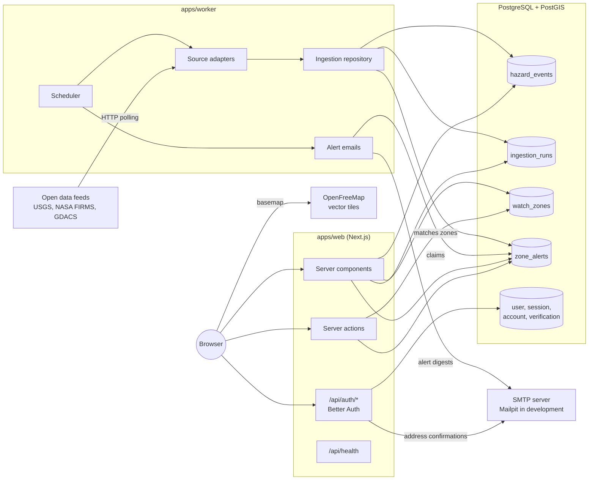
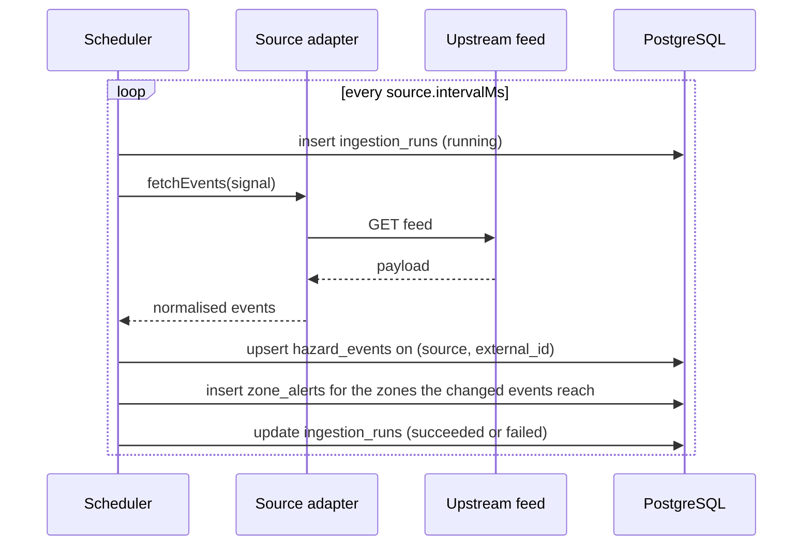

# Architecture

This document describes how HazardWatch is put together: the moving parts,
how data flows between them and the principles that guide new code. The
reasoning behind individual choices lives in the
[architecture decision records](adr/README.md).

## Overview

HazardWatch is a TypeScript monorepo with two deployable applications that
share one PostgreSQL database.

| Package          | Responsibility                                                 |
| ---------------- | -------------------------------------------------------------- |
| `apps/web`       | User-facing application: pages, authentication, HTTP endpoints |
| `apps/worker`    | Long-running process that polls hazard feeds and stores events |
| `packages/db`    | Database schema, client factory, migrations and shared types   |
| `packages/email` | SMTP sending and the templates of every email                  |

Applications depend on packages, never on each other. The database is the
only integration point between the web app and the worker.

## Components

### Web application (`apps/web`)

- **Next.js App Router.** Pages are React Server Components that read from
  the database through `@hazardwatch/db`. There is no internal REST layer
  for reads; route handlers exist only where an HTTP endpoint is required.
- **Authentication.** Better Auth handles email and password accounts.
  Sessions are stored in PostgreSQL through the Drizzle adapter, with a
  short-lived signed cookie cache to avoid a database lookup per request.
  `requireSession()` guards protected pages and the `(auth)` route group
  redirects users who are already signed in. A link sent on sign-up
  confirms the address, which alert emails require (see
  [ADR 0009](adr/0009-email-alerts-to-confirmed-addresses-from-the-worker.md));
  until then, the dashboard and the alerts page offer a new link.
- **Endpoints.** `/api/auth/*` is mounted by Better Auth. `/api/health`
  checks database connectivity and returns `503` when it is unreachable, so
  it can back a load balancer or uptime probe.
- **Configuration.** Environment variables are validated with zod when the
  server starts. Server-only modules import `server-only` so they can never
  end up in a client bundle.
- **Live map.** `/map` is public. The page reads its filters (hazard type,
  period and minimum severity) from the URL, queries the matching events
  active during the period, most recently active first and capped at
  2,000, and hands them to a client component that renders them with
  MapLibre GL on OpenFreeMap tiles (see [ADR 0005](adr/0005-render-maps-with-maplibre-and-openfreemap.md)).
  Changing a filter navigates to a new URL, and the page calls
  `router.refresh()` every minute while visible. Both re-render on the
  server and keep client state such as the map position and the selected
  event.
- **Watch zones.** Signed-in users manage the circles they watch from
  `/zones` (see [ADR 0007](adr/0007-define-watch-zones-as-circles-on-the-earths-surface.md)).
  The list sums up the past 7 days for each zone, and each zone has a page
  that reuses the live map, limited to the events located within it. Zones
  are created, edited and deleted through server actions, which check the
  session, validate the input with zod and only ever touch the signed-in
  user's zones.
- **Alerts.** `/alerts` lists the alerts raised for the user's zones, and
  the header shows how many are unread. Opening an alert goes through a
  server action that marks it as read, then shows the event on its zone's
  map. A plain link would be prefetched and mark alerts as read on its own.
- **Code shared with the browser.** Client components import domain values
  from `@hazardwatch/db/constants`, a dependency-free entry point. The main
  entry point pulls in Drizzle and the PostgreSQL driver and is reserved
  for server code.

### Ingestion worker (`apps/worker`)

- **Sources.** Each upstream feed is an adapter implementing the `Source`
  interface: an identifier, a polling interval and a `fetchEvents` function
  that returns events in the normalised shape. Feed-specific formats never
  leave the adapter. Adapters validate upstream payloads with zod: a
  malformed record is logged and skipped, while an unrecognisable payload
  fails the run.
- **HTTP.** Requests go through a shared helper that combines a timeout
  with the shutdown signal, so a stalled server cannot block a source.
- **Scheduler.** Every source is polled on its own interval. The next run
  for a source starts only after the previous one has finished, so a slow
  feed cannot pile up concurrent requests.
- **Runs.** Each pass is recorded in `ingestion_runs` with its outcome,
  the number of events written and any error. Failures are recorded rather
  than thrown, so one broken feed never stops the others.
- **Writes.** Events are upserted in batches keyed on
  `(source, external_id)`. Fetching the same feed twice is a no-op, and
  events revised upstream are updated in place. When a source reports a
  revision time, unchanged events are not rewritten at all.
- **Alerts.** In the transaction that writes a batch, the events inserted
  or revised are matched against every watch zone, and an alert is
  recorded for each zone an event reaches at or above the zone's threshold
  (see [ADR 0008](adr/0008-raise-alerts-when-events-are-written.md)).
  Alerts are raised once per zone and event, and again when the event
  grows more severe. Events that ended more than a day ago raise none.
- **Alert emails.** Every two minutes, the worker claims the alerts waiting
  to be emailed and sends each user one message listing theirs (see
  [ADR 0009](adr/0009-email-alerts-to-confirmed-addresses-from-the-worker.md)).
  Claiming locks rows with `FOR UPDATE SKIP LOCKED`, so concurrent workers
  never send the same alert, and a failed message puts its alerts back in
  the queue. Without `SMTP_URL`, this task does not run.
- **Lifecycle.** `SIGINT` and `SIGTERM` abort pending waits and close the
  connection pool, which keeps restarts and deployments clean.

#### Sources

| Source  | Feed                                                | Polled every | Hazard kinds                                           |
| ------- | --------------------------------------------------- | ------------ | ------------------------------------------------------ |
| `usgs`  | Magnitude 2.5+ earthquakes worldwide, past 24 hours | 1 minute     | Earthquake                                             |
| `gdacs` | Disaster alerts modified in the past two days       | 10 minutes   | Tropical cyclone, flood, volcano, drought and wildfire |

**USGS.** The [summary feed](https://earthquake.usgs.gov/earthquakes/feed/v1.0/geojson.php)
is regenerated every minute and covers a sliding 24-hour window, so the
worker catches up on its own after a short outage. Other seismic events,
such as quarry blasts, are ignored. Severity combines the magnitude with
the [PAGER](https://earthquake.usgs.gov/data/pager/) alert level, which
estimates human and economic impact, and keeps the higher of the two:

| Severity   | Magnitude     | PAGER alert |
| ---------- | ------------- | ----------- |
| `minor`    | below 5.0     | green       |
| `moderate` | 5.0 to 5.9    | yellow      |
| `severe`   | 6.0 to 6.9    | orange      |
| `extreme`  | 7.0 and above | red         |

**GDACS.** The [Global Disaster Alert and Coordination System](https://www.gdacs.org)
assesses the humanitarian impact of disasters worldwide. The worker pages
through the [event list API](https://www.gdacs.org/gdacsapi/swagger/index.html)
for every event modified during the past two days, so revisions are applied
in place and an outage of up to two days is caught up. GDACS also reports
earthquakes, but it takes them from USGS, so they are left out to avoid
duplicates.

A few quirks of the API are handled in the adapter:

- Timestamps are in UTC but carry no time zone designator.
- A query that matches nothing, including a page past the last one,
  answers `404` rather than an empty list.
- The list can shift between two page requests, so an event may be listed
  twice in one run. The most recently modified copy is kept, since an
  upsert cannot touch the same row twice.

Each event is located at the centroid of the affected area. It is active
from its `fromdate` to its `todate`, which moves forward as GDACS updates
the event. Severity follows the event's alert level, which estimates
whether international assistance will be needed, on the same colour scale
as PAGER:

| Severity  | GDACS alert | International assistance |
| --------- | ----------- | ------------------------ |
| `minor`   | green       | Unlikely                 |
| `severe`  | orange      | Possibly needed          |
| `extreme` | red         | Likely needed            |

### Database package (`packages/db`)

- **Schema.** Drizzle table definitions are the single source of truth for
  the database structure and the TypeScript types derived from it.
- **Migrations.** `drizzle-kit` generates SQL migrations that are reviewed
  and committed alongside the schema change. They are applied explicitly
  with `pnpm db:migrate`, never implicitly when an application starts.
- **Shared runtime.** The package re-exports the Drizzle query helpers it
  uses so that every application resolves a single `drizzle-orm` instance,
  along with conditions both applications rely on, such as the one that
  matches events to watch zones.
- **Testing.** `@hazardwatch/db/testing` creates a temporary, migrated
  database for integration tests and drops it afterwards. Run them with
  `pnpm test:integration` while the database container is up.

### Email package (`packages/email`)

- **Sending.** `createMailer` wraps a Nodemailer SMTP transport behind a
  small `Mailer` interface, which tests replace with a fake.
- **Templates.** Every email has a plain text and an HTML version, built
  from a shared layout with inline styles. Values that come from users or
  feeds are escaped.
- **Development.** Mailpit, started by `docker compose`, accepts SMTP on
  port 1025 and shows every message on <http://localhost:8025>.

## Data model

| Table                                        | Purpose                                                     |
| -------------------------------------------- | ----------------------------------------------------------- |
| `hazard_events`                              | Normalised events from every source, one per upstream event |
| `ingestion_runs`                             | Audit trail of each polling pass, used for monitoring       |
| `watch_zones`                                | Areas watched by each user, as a centre and a radius        |
| `zone_alerts`                                | Events that reached a zone, one per zone and event          |
| `user`, `session`, `account`, `verification` | Better Auth accounts and sessions                           |

`hazard_events` stores its position as a PostGIS `geometry(Point, 4326)`
(WGS 84 longitude and latitude) with a GiST index, so that proximity and
containment queries stay fast as the table grows. Fields shared by every
source are proper columns; anything source-specific is kept in a `jsonb`
`properties` column rather than widening the table.

Each event is active from `occurred_at` until `active_until`. The two are
equal for instantaneous events such as earthquakes, while lasting events
such as floods extend `active_until` with every update. Time windows match
events on `active_until`, so an event that started long ago but is still
going on is included (see [ADR 0006](adr/0006-model-hazard-events-as-activity-periods.md)).

A watch zone covers every point within `radius_km` of its `center`. Events
are matched with `ST_DWithin` on the geography type, so that distances are
measured on the Earth's surface, and a GiST index on the event location
cast to geography keeps these queries fast. Zones are deleted along with
their owner's account.

Each zone has an alert threshold, `alert_min_severity`, which is null when
the user wants no alerts. An alert keeps the severity it was last raised
with, so that only a more severe revision raises it again, and `read_at`
records when the user read it. Alerts are deleted with their zone or their
event.

`watch_zones.email_alerts` says whether a zone's alerts are also emailed,
and `zone_alerts.emailed_at` when an alert was handed to the email server.
Alerts still waiting have none, and a partial index on them keeps the
worker's lookup small.

## Ingestion flow

## Configuration

All applications read a single `.env` file at the repository root in
development. In production the same variables come from the hosting
platform.

| Variable             | Used by     | Description                                                    |
| -------------------- | ----------- | -------------------------------------------------------------- |
| `DATABASE_URL`       | web, worker | PostgreSQL connection string                                   |
| `BETTER_AUTH_SECRET` | web         | Secret used to sign session cookies                            |
| `BETTER_AUTH_URL`    | web         | Public URL of the web application                              |
| `SMTP_URL`           | web, worker | SMTP server for outgoing email. No email is sent without it    |
| `EMAIL_FROM`         | web, worker | Sender of every email, as `Name <address>`                     |
| `APP_URL`            | worker      | Public URL of the web application, for links in alert emails   |
| `LOG_LEVEL`          | worker      | `fatal`, `error`, `warn`, `info` (default), `debug` or `trace` |

## Guiding principles

- **Normalise at the edge.** Adapters translate upstream payloads into one
  event shape. The rest of the system only ever deals with that shape.
- **Make writes idempotent.** Any job may run twice; the outcome must be
  the same.
- **Isolate failures.** An unavailable feed or a malformed payload affects
  one run of one source, nothing more.
- **Fail fast on configuration.** Invalid environment variables stop the
  process at startup with a readable message, not at the first request.
- **Keep boundaries explicit.** Code shared between applications lives in a
  package with a deliberate public API.

## Roadmap

The following parts are planned and not built yet:

- A source adapter for NASA FIRMS satellite fire detections.
- An assistant that summarises the situation around a place or an event.
